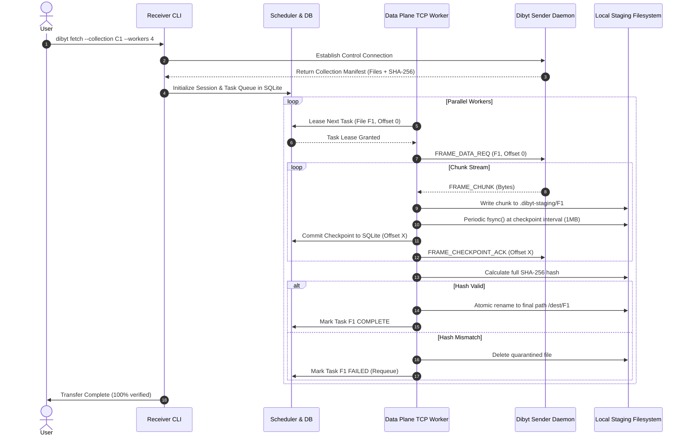

# System Architecture — Dibyt

**Document Status:** Approved Architecture Specification (v0.1)

---

## 1. Architectural Philosophy: The Modular Monolith

Dibyt is designed as a **modular monolith** in modern C++20. By deliberately avoiding microservices, Kubernetes dependencies, and external message brokers, Dibyt achieves:
1. **Zero External Runtime Daemons:** A single binary contains all runtime capabilities (CLI, daemon, worker, and scheduler).
2. **Deterministic Resource Boundaries:** Memory allocations, thread pools, and file descriptors are strictly bounded by configuration.
3. **In-Process Module Contracts:** Modules communicate via explicit, strongly-typed C++ interfaces (`std::expected`, RAII tokens), avoiding serialization overhead within the same process.
4. **Independent Evolution:** Each module is isolated within `libs/<module>`, preventing circular dependencies and allowing future decomposition only if measured production demands require it.

---

## 2. Plane Separation: Control Plane vs. Data Plane

A foundational design rule of Dibyt is the strict separation between the **Control Plane** and the **Data Plane**:

```text
+---------------------------------------------------------------------------------+
|                                 CONTROL PLANE                                   |
|                                                                                 |
|  +--------------------+     +---------------------+     +--------------------+  |
|  |     CLI11 CLI      |     | C++ Management API  |     | React Dashboard    |  |
|  |  (Terminal Client) |     | (HTTP/JSON Status)  |     | (Future Web UI)    |  |
|  +--------------------+     +---------------------+     +--------------------+  |
|            |                           |                          |             |
|            +---------------------------+--------------------------+             |
|                                        |                                        |
|                          +---------------------------+                          |
|                          | Session & Config Manager  |                          |
|                          | SQLite Metadata Database  |                          |
|                          +---------------------------+                          |
+----------------------------------------|----------------------------------------+
                                         | Leases & Tasks
                                         v
+---------------------------------------------------------------------------------+
|                                  DATA PLANE                                     |
|                                                                                 |
|       +------------------------------------------------------------------+      |
|       |                     Custom Dibyt Wire Protocol                   |      |
|       |             Length-Framed Binary Messages over Raw TCP           |      |
|       +------------------------------------------------------------------+      |
|                         |              |              |                         |
|                         v              v              v                         |
|                   [TCP Worker 1] [TCP Worker 2] [TCP Worker N]                  |
|                         |              |              |                         |
|                         +--------------+--------------+                         |
|                                        |                                        |
|                                        v                                        |
|                         +----------------------------+                          |
|                         | Disk I/O & Checkpoint Sync |                          |
|                         | Direct Payload Streaming   |                          |
|                         +----------------------------+                          |
+---------------------------------------------------------------------------------+
```

### Control Plane Rules
- Responsible for configuration, session creation, task lease management, progress monitoring, and authentication.
- Operates via local CLI flags, IPC, or lightweight JSON HTTP endpoints.
- **NEVER** routes, proxies, or buffers raw file payload data.

### Data Plane Rules
- Operates strictly over raw TCP streams using the custom binary Dibyt framing protocol.
- Optimized for zero-copy or minimal-copy chunk streaming.
- Manages connection lifecycle, frame validation, partial read/write recovery, and socket timeouts.

---

## 3. Logical Modules & Core Responsibilities

The codebase is organized into isolated, cohesive library modules under `libs/`:

| Module | Scope & Responsibility |
|---|---|
| `core` | Foundational types, GUIDs/UUIDs, error taxonomy, result wrappers (`std::expected`), time primitives, and system invariants. |
| `protocol` | Wire frame encoding and decoding, fixed header format, message schemas, magic bytes, length boundaries, and version negotiation. |
| `networking` | Socket abstraction, RAII connection wrappers, event loop / polling, non-blocking I/O loops, and timeout enforcement. |
| `manifest` | Directory tree scanning, canonical relative path normalization, symlink safety rules, and OpenSSL EVP SHA-256 calculation. |
| `transfer` | Transfer session lifecycle, chunk staging, file assembly, and atomic directory commit. |
| `scheduler` | Dynamic task queue, worker task leasing, heartbeat monitoring, lease expiration, and reassignment. |
| `storage` | SQLite wrapper, transactional schema migrations, session persistence, and durable checkpoint records. |
| `security` | Token authentication, TLS configuration, filesystem boundary validation, and secret sanitization. |
| `observability` | Structured logging (JSON/console), operational metrics (Prometheus format), and health checks. |

Executable targets in `apps/`:
- `apps/dibyt-server`: Long-running distribution daemon.
- `apps/dibyt-cli`: Client binary for publishing, fetching, and inspecting transfers.
- `apps/dibyt-api`: Embedded management HTTP daemon.

---

## 4. Scalability Principles: The 10–100 Concurrent Peer Target

Dibyt targets dependable, sustained throughput across **10 to 100 concurrent peer connections** on commodity hardware.

To prevent degradation under load, the architecture enforces:
1. **Bounded Thread Pools:** Dibyt avoids the unbounded "thread-per-connection" antipattern. Worker threads are pre-allocated up to a configured maximum.
2. **Backpressure at Socket Boundaries:** Read loops pause when local disk write queues reach saturation; send loops throttle if remote TCP windows shrink.
3. **Bounded Buffers:** Per-connection read/write buffers are strictly capped (e.g., 64 KiB chunks, maximum 1 MiB in-flight frame size).
4. **Dynamic Work Leases:** Senders do not bind specific files to specific connections. Workers dynamically request the next available task lease from the scheduler when ready.
5. **Connection Heartbeats & Lease Expiry:** If a worker drops or hangs, its task lease expires within `T_lease` (e.g., 15 seconds) and is reassigned to healthy workers.

---

## 5. Data Flow Lifecycle


